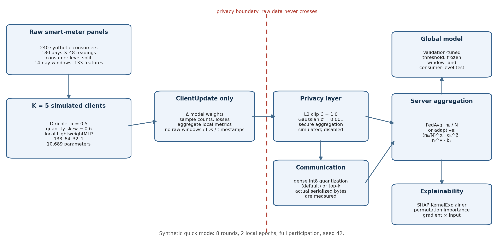
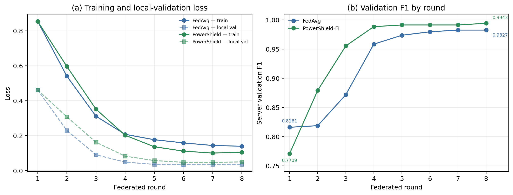
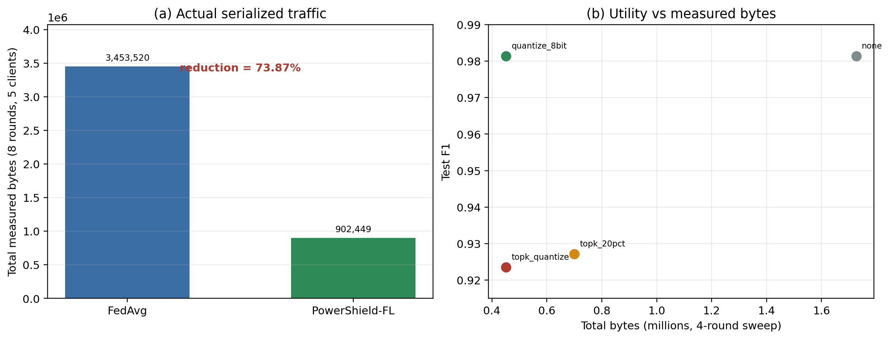
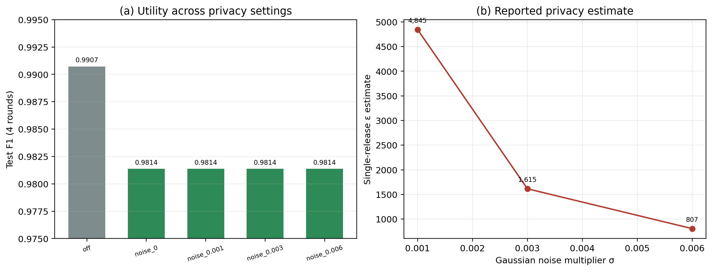
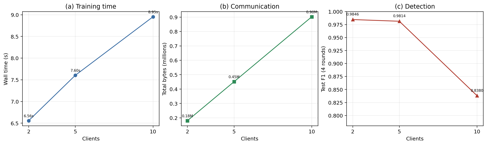
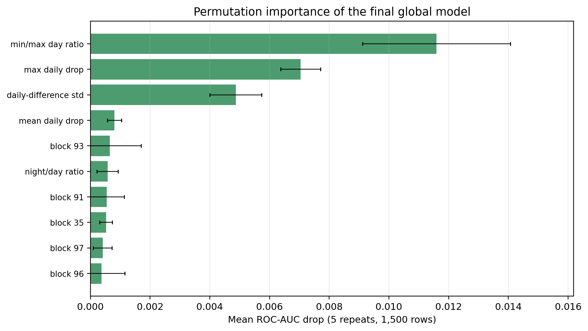
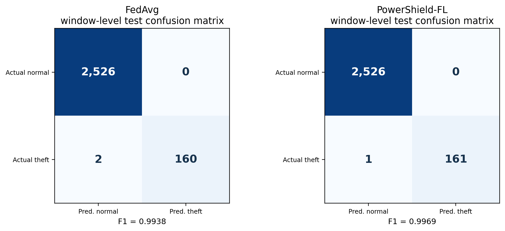
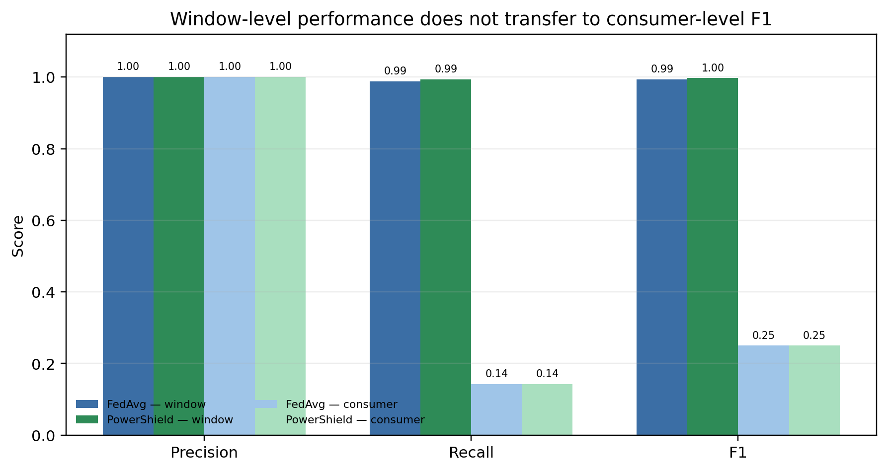

# PowerShield-FL: A Lightweight, Privacy-Aware, and Communication-Efficient Federated Learning Framework for Electricity-Theft Detection

**Author Name**  
Department of Computer Science and Engineering  
[Institution]  
[City, Country]  
[email@example.com]

**Manuscript draft — 26 October 2026**

> **DATA STATUS — SYNTHETIC DEMO DATA.** All experimental numbers in this manuscript were produced by the final QUICK-mode suite `experiment_20261025_014623_793809_suite_s42` on a synthetic smart-meter benchmark. No real utility or customer data were used. **Full mode is NOT RUN. Real-data execution is DATASET NOT CONFIGURED.**
>
> **CLAIM STATUS.** The results are single-seed, descriptive measurements. No statistical significance, formal end-to-end differential privacy, production secure aggregation, or real-world deployment claim is made.

## Abstract

Electricity theft and other non-technical losses impose substantial costs on utilities, but centralized theft detection requires pooling sensitive smart-meter records. Federated learning (FL) offers an alternative: clients train locally and share model updates rather than raw consumption data. This paper presents **PowerShield-FL**, an end-to-end research framework that combines a lightweight multi-layer perceptron, consumer-level non-IID client simulation, update clipping with Gaussian perturbation, measured communication compression, adaptive size-quality-reliability aggregation, and post-hoc explainability. We evaluate the framework on a synthetic 240-consumer benchmark in QUICK mode with five clients, eight federated rounds, and one seed. At the window level, PowerShield-FL reaches F1 = 0.9969 (precision = 1.0000, recall = 0.9938), compared with F1 = 0.9938 for FedAvg, while transmitting 902,449 bytes rather than 3,453,520 bytes—a measured reduction of 73.87%. The proposed pipeline matches the F1 of a centralized Random Forest (0.9969) without pooling raw records, although the centralized model is trained on pooled data and the comparison is not compute-matched. The apparent +0.0031 F1 advantage over FedAvg corresponds to **one additional true-positive window** out of 162 theft windows and is not statistically significant. More importantly, consumer-level F1 is only 0.25 for both methods at a fixed mean-probability threshold of 0.5, even though consumer-level ROC-AUC is 1.0; the gap is a calibration and threshold problem, not a ranking failure. The privacy layer is update-level clipping plus Gaussian noise with single-release ε estimates between 807 and 4,845; secure aggregation is simulated and disabled, and no formal end-to-end differential-privacy guarantee is claimed. Full mode and real-data experiments are **NOT RUN** and **DATASET NOT CONFIGURED**, respectively. The study supports the feasibility of lightweight, communication-efficient FL on synthetic data—not real-world deployment.

**Index Terms—** federated learning, electricity-theft detection, non-technical loss, smart meters, communication efficiency, differential privacy, non-IID data, explainability.

## 1. Introduction

Electricity theft is a persistent form of non-technical loss (NTL). It reduces utility revenue, distorts load forecasts, and can create safety and fairness problems when metered consumption no longer reflects actual use [15,16]. Smart meters make fine-grained detection possible: consumption trajectories contain signatures such as abrupt level shifts, unusual daily minima, repeated low-consumption days, and changes in peak-to-off-peak behavior. Supervised and deep learning models can learn these signatures when labelled theft records are available [17]. In practice, however, the most useful data are distributed across utilities, retailers, and customers, and centralizing raw meter readings raises privacy, regulatory, and commercial concerns.

Federated learning (FL) replaces data pooling with local training and server-side aggregation [1,2]. Each client computes an update on its private data and transmits only a model update and aggregate statistics. This reduces the immediate exposure of raw records, but it does not automatically solve the underlying problem. Client data are heterogeneous, updates can leak information [7,8], communication can be expensive, and a globally accurate window classifier may still make poor decisions at the consumer level. These issues are especially relevant for electricity theft, where the unit of operational action is a consumer or account, not an isolated sliding window.

This paper asks four questions:

- **RQ1:** Can a lightweight FL model match centralized baselines on a controlled electricity-theft benchmark?
- **RQ2:** How much communication traffic is actually saved when updates and broadcasts are compressed?
- **RQ3:** What happens to utility when clipping and Gaussian noise are enabled, and what privacy claim is justified?
- **RQ4:** Does strong window-level performance translate into useful consumer-level decisions?

We study these questions with **PowerShield-FL**, a reproducible framework that integrates preprocessing, non-IID client simulation, FedAvg and adaptive aggregation, a privacy layer, measured compression, detection thresholds, explainability, and a dashboard. The empirical work uses a synthetic benchmark in QUICK mode. The benchmark is deliberately labelled **SYNTHETIC DEMO DATA** throughout; it is a controlled testbed, not evidence about a real utility.

The main contributions are:

1. **An end-to-end FL framework** for electricity-theft detection that keeps raw windows client-local and transmits only `ClientUpdate` objects (model delta plus aggregate statistics).
2. **A leakage-safe consumer-level pipeline** in which consumers—not windows—are split into train, validation, and test sets; scalers and outlier bounds are fitted on training consumers only.
3. **A measured systems evaluation** covering window-level detection, actual serialized bytes, privacy-related perturbation, scalability, adaptive aggregation diagnostics, and model explanations.
4. **A candid negative result:** high window-level F1 does not imply useful consumer-level F1. At a fixed consumer threshold, both FedAvg and PowerShield-FL detect only one of seven theft consumers, despite perfect consumer-level ranking.

The remainder of the paper is organized as follows. Section 2 reviews related work. Section 3 describes the methodology. Section 4 presents the experimental setup. Section 5 reports results. Section 6 discusses implications and threats to validity. Section 7 states limitations, and Section 8 concludes.

## 2. Related Work

### 2.1 Electricity-Theft Detection

Electricity-theft detection is usually framed as a supervised classification problem over consumption features, load profiles, or raw time series. Classical approaches use statistical tests, rule-based thresholds, and customer-level features; machine-learning approaches include logistic regression, support vector machines, random forests [19], gradient boosting, and neural networks [15,16]. Deep models can learn temporal patterns directly, but they require more data and compute and are harder to explain. The SGCC dataset has become a common benchmark for data-driven theft detection [17].

Three evaluation issues recur in this literature. First, consumer labels are often much scarcer than window labels, and window-level accuracy can overstate consumer-level usefulness. Second, class imbalance is severe; precision, recall, and PR-AUC are more informative than accuracy. Third, reported performance is often obtained after pooling all records, which is precisely the setting that FL is meant to avoid. PowerShield-FL addresses these issues by reporting both window- and consumer-level results and by making the centralized versus federated trade-off explicit.

### 2.2 Federated Learning and Heterogeneity

Early federated optimization work studied distributed training without centralized data [25], and FedAvg became the canonical algorithm: clients perform local stochastic gradient descent, and the server averages their updates weighted by sample count [1]. Its behavior degrades when client distributions differ. FedProx adds a proximal term to limit client drift [3], SCAFFOLD uses control variates to correct client drift [4], and adaptive server optimizers adjust global updates [24]. Non-IID partitioning is commonly simulated with Dirichlet label proportions or quantity skew [5,6]. In this work, clients are formed at the consumer level with a Dirichlet label partition and an additional quantity skew, producing deliberately uneven client sizes and theft ratios.

### 2.3 Privacy and Secure Aggregation

FL reduces raw-data exposure but does not by itself provide differential privacy (DP). Membership-inference and gradient-leakage attacks show that updates can reveal information about training records [7,8]. DP provides a formal framework for limiting the influence of any single record [9,11], and secure aggregation prevents the server from observing individual updates [10]. Practical FL systems often combine clipping, noise, and secure aggregation.

These mechanisms have costs. DP noise can reduce utility, clipping introduces bias when updates are large, and secure aggregation adds cryptographic overhead. Moreover, a single-release Gaussian-mechanism estimate is not an end-to-end DP guarantee: composition across rounds, client sampling, and the threat model must be accounted for. PowerShield-FL implements clipping and Gaussian perturbation as a research layer, reports single-release ε estimates, and explicitly avoids claiming a formal end-to-end guarantee. Secure aggregation is implemented only as a simulated additive-masking demonstration and is disabled in the reported runs.

### 2.4 Communication-Efficient FL

Communication is often the bottleneck in FL. Quantization reduces the number of bits per parameter [12], gradient compression sends only selected coordinates [13], and sparse ternary compression combines sparsification with quantization [14]. These methods trade accuracy for bandwidth. The trade-off depends on model size, sparsity, and whether indices or metadata dominate the payload.

A central methodological point is that compression should be measured from actual serialized bytes, not estimated from parameter counts. PowerShield-FL instruments upload and download traffic, including per-tensor headers and top-k indices. It compares dense float32, dense int8 quantization, top-k sparsification, and top-k plus int8. For a small dense model, dense int8 is expected to be competitive because top-k must transmit integer indices; the experiments test this expectation rather than assuming it.

### 2.5 Explainability and the Evaluation Gap

Explainability is important in security operations: an analyst needs to know why a consumer or window was flagged. SHAP provides additive feature attributions under a cooperative-game interpretation [18], and permutation importance measures the drop in a model score when a feature is shuffled. Both are model-specific diagnostic tools, not causal explanations.

The literature on FL for energy analytics is growing, but evaluation practices remain uneven. Window-level F1 is often reported without byte-level communication, consumer-level decisions, calibration, or statistical uncertainty. This paper does not claim a new state-of-the-art detector. It contributes a transparent, reproducible evaluation of an integrated FL pipeline under a controlled synthetic workload, including the failure modes that a deployment-oriented study should expose.

## 3. Methodology

### 3.1 Problem Setting

Let consumers be indexed by *c* and let each consumer have a sequence of half-hourly meter readings. A sliding window of *W* days is represented by a feature vector **x** and a binary label *y* ∈ {0,1}. The global model *f*θ maps **x** to a theft probability. In federated training, *K* clients hold disjoint subsets of consumers; client *k* has *n*ₖ training windows. The server never receives raw windows, timestamps, or customer identifiers.

The optimization objective is the class-weighted binary cross-entropy

$$ L(θ) = Σₖ (nₖ / N) · Lₖ(θ), $$

where *L*ₖ is the local loss on client *k* and *N* = Σₖ *n*ₖ. Class weights compensate for the low theft prevalence in the training split. The server-side evaluation uses a held-out set of consumers that are disjoint from all clients.

### 3.2 Framework Overview

Figure 1 summarizes the pipeline. Raw smart-meter panels are split by consumer into training, validation, and test sets. Training consumers are assigned to simulated clients. Each client fits a local copy of the lightweight model, clips and perturbs its update, optionally compresses it, and sends a `ClientUpdate` to the server. The server decompresses, aggregates with either FedAvg or the adaptive rule, and broadcasts the new global model. The global model is evaluated at the window level and at the consumer level. Explainability tools operate on the final global model.

**Figure 1.** Conceptual overview of PowerShield-FL. The diagram is illustrative; no measured values are encoded in it. Raw windows, timestamps, and customer identifiers remain client-local. The privacy boundary separates client-side data from the server-visible `ClientUpdate` stream.

> **Threat model.** Clients are honest and the server is honest-but-curious. The server observes only `ClientUpdate` objects, not raw data. We do not evaluate malicious clients, poisoning, backdoors, or active inference attacks. The privacy layer is a perturbation mechanism, not a formal DP system. Secure aggregation is simulated and disabled.

### 3.3 Data Construction and Leakage Control

The synthetic generator creates 240 consumers over 180 days at 30-minute resolution: 2,073,600 raw rows in total. Each consumer has a base load, an intraday profile, seasonal and weekend factors, Gaussian noise, missing values, and occasional spikes. Fifteen percent of consumers (36 of 240) are assigned a theft episode. For a theft consumer, metered consumption is multiplied by a scale factor between 0.35 and 0.85 from a random activation day, with a 25% chance that a given day is inactive; the activation day lies between 25% and 85% of the observation period. These settings produce a detectable but non-trivial pattern of level reduction.

The split unit is the **consumer**, not the window. Consumers are divided into 156 training, 36 validation, and 48 test consumers (65%/15%/20%). All windows from a consumer remain in exactly one split. Cleaning statistics, outlier bounds, and feature scalers are fitted on training consumers only and then applied to validation and test consumers. This prevents identity leakage and avoids fitting preprocessing objects on held-out data.

Each consumer is converted into 14-day sliding windows with a stride of 3 days, yielding 56 windows per consumer and 13,440 windows in total. From each window, the pipeline computes eight intraday block means per day (8 × 14 = 112 values) plus 21 engineered statistics, for 133 features. Engineered features include mean, standard deviation, minimum, maximum, median consumption, peak/off-peak ratios, daily drops, daily-difference variability, night/day ratios, weekend/weekday ratios, and calendar terms. The theft anomalies are clipped rather than deleted during outlier handling, so the label distribution is preserved.

Window labels respect the synthetic theft activation day: a window is positive only if it overlaps the theft period. This avoids labelling pre-theft behavior as theft. The training split contains 8,736 windows with 706 positive windows (8.08%); validation contains 2,016 windows with 176 positives (8.73%); test contains 2,688 windows with 162 positives (6.03%). At the consumer level, the test split contains 7 theft consumers and 41 normal consumers.

### 3.4 Lightweight Detector

The proposed detector is a fully connected network:

$$ 133 → 64 → 32 → 1, $$

with ReLU activations, dropout 0.2 after each hidden layer, and a single logit output. It has 10,689 trainable parameters and a parameter payload of 41.75 KiB. The loss is class-weighted binary cross-entropy with weights 0.544 for normal windows and 6.187 for theft windows. The optimizer is Adam with learning rate 0.001, weight decay 0.0001, and batch size 128 [22].

This architecture is intentionally small. It is not a claim that a shallow MLP is the best possible detector; it is a controlled test of whether a compact model can operate under FL constraints on CPU hardware. The same architecture is used by FedAvg and PowerShield-FL, which makes the federated comparison architecture-controlled.

### 3.5 Federated Training

Training consumers are partitioned across five clients. The partition uses a Dirichlet label partition with concentration α = 0.5 plus quantity skew 0.6, so clients differ in both class balance and sample count [5,6]. Each client reserves 15% of its assigned windows for local validation; the server’s global validation set is a separate set of 36 consumers. All five clients participate in every round. Each round consists of two local epochs over the client’s training windows, followed by aggregation and server-side validation.

FedAvg aggregates client updates by sample count:

$$ w(t+1) = Σₖ (nₖ / N) · wₖ(t+1). $$

The FedAvg baseline uses no privacy perturbation and no compression. PowerShield-FL uses the same model, partition, local optimizer, and number of rounds, but adds adaptive aggregation, clipping and Gaussian perturbation, and int8 compression. The headline comparison is therefore a **system-level** comparison, not an isolated ablation of aggregation. The privacy and communication sweeps in Section 5 vary one layer at a time.

### 3.6 Adaptive Aggregation

FedAvg gives a large client substantial influence simply because it has more windows. The adaptive rule multiplies four client-specific factors:

$$ aₖ ∝ (nₖ / N)^α · qₖ^β · rₖ^γ · bₖ, $$

where *q*ₖ is local validation quality, *r*ₖ is update-norm reliability, and *b*ₖ is a class-balance factor. The implementation uses α = 1.0, β = 0.5, γ = 0.5, quality floor 0.1, balance strength λ = 0.2, minimum normalized weight 0.01, and robust clipping of **normalized client weights** at three times the mean weight.

Local quality is

$$ qₖ = max(0.5 · F1ₖ + 0.5 · AUCₖ, q_min) $$

when both classes are present in the client’s local validation set; otherwise it is `max(0.5, q_min)`. The fallback is important: a client with no theft windows cannot have a meaningful local F1, and assigning it zero quality would discard a legitimate source of normal-behavior data. Reliability is

$$ rₖ = exp(-| ||Δₖ|| / median(||Δ||) - 1 |), $$

which penalizes updates whose norm is far from the median. The balance factor is

$$ bₖ = (1 - λ) + λ · 2√(pₖ(1 - pₖ)), $$

where *p*ₖ is the client’s local theft ratio. A client with no theft windows receives the lowest balance factor, but is not removed. The resulting weights are normalized and floored.

### 3.7 Privacy Layer

For each client update Δₖ, the privacy layer first performs L2 clipping:

$$ Δ′ₖ = Δₖ · min(1, C / ||Δₖ||₂), $$

with C = 1.0. It then adds element-wise Gaussian noise:

$$ Δ̃ₖ = Δ′ₖ + N(0, σ²C²I), $$

with σ = 0.001 and δ = 10⁻⁵. The server receives Δ̃ₖ, not the raw update. The code reports a single-release Gaussian-mechanism estimate

$$ ε ≈ √(2 ln(1.25/δ)) / σ. $$

This estimate is descriptive. It does not account for composition over eight rounds, client sampling, or the fact that secure aggregation is disabled. Formal accounting would require a composition mechanism such as Rényi differential privacy [26] together with an explicit threat model. The paper therefore does **not** claim that the full training procedure satisfies (ε, δ)-DP. The reported ε values are useful mainly for showing how weak the perturbation is at σ = 0.001: the estimates are in the thousands, not in a regime that would support a meaningful formal guarantee.

Secure aggregation is implemented as a simulated additive-masking demonstration. It is disabled in the main run and in all reported sweeps. No production cryptographic protocol is used, and the server is assumed to observe individual perturbed updates.

### 3.8 Communication Layer

The communication layer supports four modes:

- **None:** float32 tensors with a small header.
- **Int8 quantization:** symmetric per-tensor quantization with a scale and zero-point-free representation.
- **Top-k:** keep the largest 20% of coordinates by magnitude, transmit values plus int32 indices.
- **Top-k + int8:** top-k selection followed by int8 quantization of the selected values.

For int8 quantization, each tensor uses

$$ q = round(v / s), s = max|v| / 127, $$

where *s* is transmitted as metadata. The default PowerShield-FL configuration uses dense int8 quantization for both client uploads and server broadcasts. Payload sizes are measured from the actual serialized byte streams, including per-tensor headers and top-k indices. They are not estimated from the number of parameters.

### 3.9 Detection and Consumer-Level Aggregation

The window-level decision threshold is selected on the server validation set from the grid 0.05, 0.10, …, 0.95 by maximizing validation F1. The selected threshold is then frozen and applied once to the held-out test consumers. For interpretation, predictions within ±0.15 of the threshold are labelled `UNCERTAIN`; otherwise they are `NORMAL` or `POTENTIAL_THEFT`.

The consumer-level diagnostic is deliberately simple: for each test consumer, average the predicted window probabilities and threshold the mean at 0.5. This is the metric reported in the paper. It is not tuned on validation consumers. The project also contains a positive-window-ratio verdict rule for operational postprocessing, but that rule is not the metric used in the consumer-level table. This distinction matters because the choice of consumer aggregation rule can change the apparent deployment performance.

### 3.10 Explainability

Three complementary tools are applied to the final global model:

- **Permutation importance:** shuffle one feature at a time, measure the drop in ROC-AUC, and repeat five times over 1,500 test windows.
- **SHAP:** KernelExplainer with 40 test windows, a 30-row background sample, and 100 evaluation samples.
- **Gradient × input:** local attributions for 10 correctly classified windows.

These methods answer different questions. Permutation importance measures model reliance at the dataset level; SHAP gives additive local attributions; gradient × input gives a first-order sensitivity view. None establishes causality.

## 4. Experimental Setup

### 4.1 Data and Splits

Table 1 summarizes the synthetic dataset. The benchmark is generated from seed 42 and is labelled **SYNTHETIC DEMO DATA** in every artifact. It contains 2,073,600 raw rows, 4,244 missing values, and zero duplicate rows. The 240 consumers are split into 156 training, 36 validation, and 48 test consumers. The training split is used for client partitioning; the validation split is held by the server; the test split is untouched until final evaluation.

**Table 1. Synthetic dataset and split summary (SYNTHETIC DEMO DATA).**

| Item | Train | Validation | Test | Total |
|---|---:|---:|---:|---:|
| Consumers | 156 | 36 | 48 | 240 |
| Theft consumers | 24 | 5 | 7 | 36 |
| Windows | 8,736 | 2,016 | 2,688 | 13,440 |
| Theft windows | 706 | 176 | 162 | 1,044 |
| Theft ratio | 8.08% | 8.73% | 6.03% | 7.77% |
| Windows per consumer | 56 | 56 | 56 | 56 |

**Raw data:** 2,073,600 rows; 4,244 missing values; 0 duplicate rows; 133 features; 14-day windows; stride 3 days. The theft consumers are 36 of 240 (15%). The total theft-window count and ratio are arithmetic sums over the three splits.

### 4.2 Client Simulation

Table 2 reports the realized client partition. Client sizes range from 336 to 3,640 windows, and theft ratios range from 0% to 17.16%. Client 03 contains 43 consumers and no theft windows; this is not a preprocessing error but a consequence of the deliberately heterogeneous partition. The all-normal client tests the adaptive quality fallback and the balance factor.

**Table 2. Realized non-IID client partition of the training consumers (SYNTHETIC DEMO DATA).**

| Client | Consumers | Assigned windows | Theft windows | Theft ratio | Local train | Local validation |
|---|---:|---:|---:|---:|---:|---:|
| client_00 | 36 | 2,016 | 346 | 17.16% | 1,714 | 302 |
| client_01 | 65 | 3,640 | 329 | 9.04% | 3,094 | 546 |
| client_02 | 6 | 336 | 18 | 5.36% | 286 | 50 |
| client_03 | 43 | 2,408 | 0 | 0.00% | 2,047 | 361 |
| client_04 | 6 | 336 | 13 | 3.87% | 286 | 50 |
| **Total** | **156** | **8,736** | **706** | **8.08%** | **7,427** | **1,309** |

### 4.3 Baselines

The study compares three families:

- **Centralized ML:** logistic regression, random forest, a heavier MLP, the lightweight MLP trained centrally, and a CNN-LSTM. These models are trained on pooled training windows and are included as accuracy and cost references, not as privacy-preserving alternatives.
- **FedAvg:** the same lightweight architecture and client partition as PowerShield-FL, with sample-count aggregation, no privacy perturbation, and no compression.
- **PowerShield-FL:** adaptive aggregation, clipping plus Gaussian perturbation, dense int8 compression, and explainability.

The centralized models use the following quick-mode settings: logistic regression with balanced class weights and 500 iterations; random forest with 200 trees, maximum depth 12, and balanced class weights; central MLP with hidden layers 128 and 64, dropout 0.2, 8 epochs, batch 128, and Adam; lightweight central MLP with the same architecture as the federated model and 8 epochs; CNN-LSTM with 16 convolution channels, LSTM hidden size 32, kernel size 3, dropout 0.2, and 6 epochs [23]. The CNN-LSTM is included as a heavy temporal baseline, but it is not extensively tuned in QUICK mode; its result should not be read as a claim that CNN-LSTMs are inherently unsuitable.

### 4.4 Implementation and Hyperparameters

The implementation is Python 3.10+ with PyTorch on CPU [21], scikit-learn for classical baselines [20], and SHAP for explanations [18]. The reported environment is Python 3.14.5 on Windows 11, a CPU-only host with 10 physical and 12 logical cores and 15.72 GB RAM; PyTorch is 2.14.1+cpu. All randomness flows through a single seed utility; the main run uses seed 42.

The federated configuration is: 5 clients, full participation, 8 rounds, 2 local epochs per round, batch size 128, Adam with learning rate 0.001 and weight decay 0.0001, and class-weighted binary cross-entropy. The model is 133→64→32→1 with dropout 0.2 and 10,689 parameters. Privacy uses C = 1.0, σ = 0.001, δ = 10⁻⁵, and secure aggregation simulated but disabled. Compression is dense int8 for both uploads and broadcasts. Adaptive aggregation uses α = 1.0, β = 0.5, γ = 0.5, quality floor 0.1, λ = 0.2, minimum weight 0.01, and robust clipping of normalized client weights at 3× the mean weight.

### 4.5 Metrics

Window-level detection is evaluated with accuracy, precision, recall, F1, ROC-AUC, PR-AUC, and the confusion matrix. The threshold is tuned on validation F1 and frozen before test evaluation. Consumer-level detection uses the mean window probability per consumer and a fixed threshold of 0.5; precision, recall, F1, ROC-AUC, PR-AUC, and confusion counts are reported. Communication is measured in actual serialized bytes for uploads and downloads. Computational cost is measured as wall-clock training time, parameter count, parameter payload, and per-sample inference time. Resource measurements are machine-specific.

### 4.6 Statistical Protocol

The suite used one seed. Consequently, the paper reports descriptive point estimates only. It does **not** report confidence intervals over seeds, paired t-tests, or Wilcoxon tests. The exact status is **STATISTICAL TEST NOT RUN — fewer than 2 paired seeds**. The +0.0031 F1 difference between PowerShield-FL and FedAvg is discussed as a one-window difference, not as evidence of a statistically reliable improvement.

### 4.7 Reproducibility

The authoritative artifacts are the final quick suite `experiment_20261025_014623_793809_suite_s42`, the machine-readable `results/metrics/summary.json`, the generated report `results/reports/final_experiment_report.md`, and `FINAL_STATUS.md`. The main FedAvg and PowerShield-FL runs are `experiment_20261025_014756_354071_fedavg_s42` and `experiment_20261025_014812_413345_powershield_s42`, respectively. The project passed 33 tests; the pipeline checks reported 12 PASS, 1 WARNING (the expected synthetic-data warning), and 0 FAIL. The dashboard loaded 10 tabs with zero exceptions, and notebooks 1–5 executed. Full mode (600 consumers, 10 clients, 25 rounds, 3 seeds, 20-client scalability) is **NOT RUN**. Real SGCC/IRISE execution is **DATASET NOT CONFIGURED**.

## 5. Results

All results in this section are measured on **SYNTHETIC DEMO DATA**. The main comparison uses eight rounds and seed 42. The privacy, communication, and scalability sweeps use four rounds and are therefore not directly comparable in absolute F1 to the eight-round main run.

### 5.1 Dataset and Partition

The realized partition is strongly non-IID (Table 2). The largest client owns 3,640 of 8,736 windows (41.7%), while the two smallest clients own 336 windows each (3.85%). Theft prevalence ranges from 0% to 17.16%. This is a harder partition than an IID deal and is intended to stress the aggregation rule. The all-normal client is particularly important: its local validation set has only one class, so the quality fallback assigns 0.5 rather than treating the client as useless.

### 5.2 Centralized Baselines

Table 3 reports centralized detection. Random Forest and PowerShield-FL both reach F1 = 0.9969, but the Random Forest is trained on pooled raw data and therefore does not provide the privacy contrast that motivates FL. Logistic Regression is close behind at F1 = 0.9938, with 134 coefficients and a 1.05 KiB payload. The heavier centralized MLP reaches only F1 = 0.8750 because of low precision (0.7816): it produces more false positives at its validation-tuned threshold. The CNN-LSTM reaches F1 = 0.7634, with recall 0.6173 and ROC-AUC 0.9444; in QUICK mode it is under-trained and is not a tuned temporal baseline.

**Table 3. Centralized detection results on the held-out test consumers (SYNTHETIC DEMO DATA).**

| Method | Accuracy | Precision | Recall | F1 | ROC-AUC | PR-AUC | Threshold |
|---|---:|---:|---:|---:|---:|---:|---:|
| Logistic Regression | 0.9993 | 0.9938 | 0.9938 | 0.9938 | 0.9986 | 0.9952 | 0.20 |
| Random Forest | 0.9996 | 1.0000 | 0.9938 | 0.9969 | 0.9950 | 0.9942 | 0.35 |
| Central MLP | 0.9829 | 0.7816 | 0.9938 | 0.8750 | 0.9996 | 0.9967 | 0.25 |
| Central lightweight MLP | 0.9933 | 0.9045 | 0.9938 | 0.9471 | 0.9991 | 0.9958 | 0.25 |
| CNN-LSTM | 0.9769 | 1.0000 | 0.6173 | 0.7634 | 0.9444 | 0.7797 | 0.45 |

Table 4 reports resource use. The Random Forest has 21,862 tree nodes and a 170.80 KiB payload estimate; its 0.5187 ms per-sample inference is measured through scikit-learn’s Python path and is not a like-for-like optimized benchmark against batched PyTorch inference. The lightweight model has 10,689 parameters and a 41.75 KiB parameter payload. The centralized Lightweight MLP trains in 7.52 s, while the federated PowerShield-FL run takes 15.97 s for eight rounds of five clients. The training budgets are not compute-matched: the centralized lightweight model performs 8 epochs on pooled data, whereas each federated client performs 2 local epochs per round over 8 rounds. The centralized results should therefore be read as references, not as a controlled architecture comparison.

**Table 4. Centralized and federated resource use (SYNTHETIC DEMO DATA).**

| Method | Parameters | Payload (KiB) | Train time (s) | Inference (ms/sample) |
|---|---:|---:|---:|---:|
| Logistic Regression | 134 | 1.05 | 0.50 | 0.0032 |
| Random Forest | 21,862 nodes | 170.80 | 5.17 | 0.5187 |
| Central MLP | 25,473 | 99.50 | 15.45 | 0.0058 |
| Central lightweight MLP | 10,689 | 41.75 | 7.52 | 0.0042 |
| CNN-LSTM | 21,617 | 84.44 | 36.16 | 0.1587 |
| FedAvg (federated) | 10,689 | 41.75 | 15.51 | 0.0048 |
| PowerShield-FL (federated) | 10,689 | 41.75 | 15.97 | 0.0040 |

### 5.3 Federated Detection

Table 5 compares FedAvg and PowerShield-FL. Both use the same model and partition. FedAvg reaches F1 = 0.9938 with precision 1.0000 and recall 0.9877; PowerShield-FL reaches F1 = 0.9969 with precision 1.0000 and recall 0.9938. The difference is +0.0031 F1, which corresponds to one additional true-positive test window: FedAvg has TP = 160 and FN = 2; PowerShield-FL has TP = 161 and FN = 1. Both have FP = 0 and TN = 2,526. This is a single-window difference out of 162 positive windows, not a meaningful performance separation. The window-level ROC-AUC is slightly higher for FedAvg (0.9973) than for PowerShield-FL (0.9969), so the ranking quality does not uniformly favor the proposed system.

**Table 5. Federated window-level comparison (SYNTHETIC DEMO DATA).**

| Method | Precision | Recall | F1 | ROC-AUC | PR-AUC | Time (s) | Total bytes |
|---|---:|---:|---:|---:|---:|---:|---:|
| FedAvg | 1.0000 | 0.9877 | 0.9938 | 0.9973 | 0.9927 | 15.51 | 3,453,520 |
| PowerShield-FL | 1.0000 | 0.9938 | 0.9969 | 0.9969 | 0.9945 | 15.97 | 902,449 |

Both methods use 8 rounds and the same 10,689-parameter model. FedAvg uses sample-count aggregation with privacy off and compression off. PowerShield-FL uses adaptive aggregation, clipping plus Gaussian perturbation, and dense int8 compression.

Figure 2 shows the convergence traces. PowerShield-FL overtakes FedAvg by round 2 and remains ahead, but both models are already near the ceiling of the synthetic task. The validation F1 at the final round is 0.9943 for PowerShield-FL and 0.9827 for FedAvg; the final test values differ by one window. The curves should not be interpreted as evidence that adaptive aggregation causally improves learning, because privacy and compression also differ between the two systems and no aggregation-only ablation was run.

**Figure 2.** Validation convergence and loss over eight federated rounds (SYNTHETIC DEMO DATA). The dashed curves are local-validation losses; the solid curves are training losses. Test values are reported separately in Table 5.

### 5.4 Communication Efficiency

PowerShield-FL transmits 902,449 bytes over eight rounds, compared with 3,453,520 bytes for FedAvg—a measured reduction of 73.87% (Table 5 and Figure 3a). The reduction is symmetric: FedAvg sends 1,726,760 bytes in each direction, while PowerShield-FL sends 451,294 bytes up and 451,155 bytes down. Per client per round, the proposed system uses 22,561 bytes on average, versus 86,338 bytes for FedAvg. The saving comes from dense int8 quantization applied to both updates and broadcasts; it is not an estimate from parameter counts.

The compression sweep (Table 6 and Figure 3b) isolates the compression choice over four rounds. Dense int8 quantization preserves the same test F1 as no compression (0.9814) while reducing bytes from 1,726,760 to 451,222. Top-k 20% is less effective: its F1 falls to 0.9272 and its payload is 700,440 bytes, because the int32 indices dominate for a small dense model. Top-k plus int8 reaches 451,227 bytes but has the lowest F1 (0.9236). For this model, dense int8 is the better communication choice; top-k is not automatically efficient.

**Table 6. Communication-compression sweep over four rounds (SYNTHETIC DEMO DATA).**

| Compression | Precision | Recall | F1 | ROC-AUC | Total bytes | Reduction vs none |
|---|---:|---:|---:|---:|---:|---:|
| None (float32) | 0.9875 | 0.9753 | 0.9814 | 0.9971 | 1,726,760 | 0.00% |
| Dense int8 | 0.9875 | 0.9753 | 0.9814 | 0.9970 | 451,222 | 73.87% |
| Top-k 20% | 1.0000 | 0.8642 | 0.9272 | 0.9950 | 700,440 | 59.44% |
| Top-k + int8 | 1.0000 | 0.8580 | 0.9236 | 0.9948 | 451,227 | 73.87% |

**Figure 3.** Measured communication over eight rounds and the four-round compression sweep (SYNTHETIC DEMO DATA). (a) Actual serialized traffic includes uploads, downloads, headers, and indices. (b) Dense int8 preserves the clipping-only F1 at 451,222 bytes; top-k pays for int32 indices and loses recall.

### 5.5 Privacy-Utility Sweep

Table 7 and Figure 4 report the four-round privacy sweep. With privacy off, F1 is 0.9907. With clipping only (σ = 0), F1 is 0.9814. With clipping plus Gaussian noise at σ = 0.001, 0.003, or 0.006, F1 remains 0.9814. The measured difference between privacy-off and the privacy-enabled configurations is therefore associated with **clipping**, not with the small Gaussian noise: all three nonzero-noise settings recover the clipping-only result. This sweep does not establish a privacy-utility trade-off curve.

The single-release ε estimates are 4,844.81, 1,614.94, and 807.47 for σ = 0.001, 0.003, and 0.006, respectively. These values are large. In the final round of the main run, one of five clients was clipped; the mean original update norm was 0.5831, the mean noise norm was 0.1035, and the noise-to-signal ratio was 0.1774. The perturbation is small relative to the update, which helps utility but provides limited formal protection. The correct reading is that the privacy layer is a demonstration mechanism, not a deployment-grade DP guarantee.

**Table 7. Privacy sweep over four rounds (SYNTHETIC DEMO DATA).**

| Privacy setting | Precision | Recall | F1 | ROC-AUC | Single-release ε |
|---|---:|---:|---:|---:|---:|
| Off | 0.9938 | 0.9877 | 0.9907 | 0.9974 | — |
| Clipping only (σ = 0) | 0.9875 | 0.9753 | 0.9814 | 0.9970 | — |
| Clip + noise σ = 0.001 | 0.9875 | 0.9753 | 0.9814 | 0.9970 | 4,844.81 |
| Clip + noise σ = 0.003 | 0.9875 | 0.9753 | 0.9814 | 0.9970 | 1,614.94 |
| Clip + noise σ = 0.006 | 0.9875 | 0.9753 | 0.9814 | 0.9969 | 807.47 |

**Figure 4.** Four-round privacy sweep (SYNTHETIC DEMO DATA). (a) Clipping alone explains the observed F1 change; the tested Gaussian noise levels do not change F1 further. (b) Single-release ε estimates are large and are not an end-to-end privacy guarantee.

### 5.6 Scalability

Table 8 and Figure 5 report a four-round scalability sweep with 2, 5, and 10 clients. Wall time rises from 6.558 s to 7.604 s to 8.954 s, and total bytes rise from 180,497 to 451,222 to 902,445. The byte growth is essentially linear in the number of clients because all clients participate and both uploads and broadcasts are counted. Test F1 is 0.9846 with 2 clients, 0.9814 with 5 clients, and 0.8380 with 10 clients. The 10-client drop is large, but the sweep uses only four rounds and does not tune hyperparameters per client count. It should be read as a warning about small per-client sample sizes and short training, not as a scalability law.

**Table 8. Scalability sweep over four rounds (SYNTHETIC DEMO DATA).**

| Clients | Accuracy | Precision | Recall | F1 | ROC-AUC | Wall time (s) | Total bytes |
|---:|---:|---:|---:|---:|---:|---:|---:|
| 2 | 0.9981 | 0.9816 | 0.9877 | 0.9846 | 0.9954 | 6.558 | 180,497 |
| 5 | 0.9978 | 0.9875 | 0.9753 | 0.9814 | 0.9970 | 7.604 | 451,222 |
| 10 | 0.9829 | 0.9754 | 0.7346 | 0.8380 | 0.9861 | 8.954 | 902,445 |

**Figure 5.** Four-round scalability sweep with 2, 5, and 10 clients (SYNTHETIC DEMO DATA). Time and bytes grow with participation; the 10-client F1 drop is confounded with short training and small per-client samples.

### 5.7 Adaptive Aggregation Diagnostics

Table 9 reports the final-round aggregation diagnostics. FedAvg gives client_03—the all-normal client with 2,408 assigned windows—a weight of 0.2756 because of its sample count. The adaptive rule reduces that weight to 0.1212, reflecting its low reliability (0.2802) and the lowest possible balance factor (0.8000). The client is not eliminated: its quality fallback is 0.5000 and its minimum weight remains above the 0.01 floor. At the same time, client_00 and client_01 increase their weights from 0.2308/0.4166 to 0.3208/0.4756. This is the intended behavior of the size-quality-reliability rule.

The table is diagnostic, not causal. Because FedAvg also differs in privacy and compression, the final F1 difference cannot be attributed to these weight changes. An aggregation-only ablation is not available in the current suite.

**Table 9. Final-round aggregation diagnostics (SYNTHETIC DEMO DATA).**

| Client | FedAvg weight | Adaptive weight | Quality | Reliability | Balance | Update norm |
|---|---:|---:|---:|---:|---:|---:|
| client_00 | 0.2308 | 0.3208 | 0.9879 | 1.0000 | 0.9522 | 0.4800 |
| client_01 | 0.4166 | 0.4756 | 0.9958 | 0.7282 | 0.9127 | 0.6322 |
| client_02 | 0.0385 | 0.0400 | 0.8636 | 0.7363 | 0.8863 | 0.3331 |
| client_03 | 0.2756 | 0.1212 | 0.5000 | 0.2802 | 0.8000 | 1.0907 |
| client_04 | 0.0385 | 0.0424 | 0.9000 | 0.8112 | 0.8769 | 0.3796 |

### 5.8 Explainability

Permutation importance over 1,500 test windows and five repeats has a baseline ROC-AUC of 0.996682. The most important features are `min_max_day_ratio` (0.01159 ± 0.00248), `max_daily_drop` (0.00704 ± 0.00067), `daily_diff_std` (0.00487 ± 0.00087), `mean_daily_drop` (0.000802 ± 0.000236), and `block_93` (0.000648 ± 0.001055). Figure 6 shows the top ten. The top features are consistent with the synthetic theft mechanism, which multiplies consumption by a factor below one: ratios and drop statistics are exactly the kind of signal the generator creates. This is evidence that the model uses plausible features on this benchmark, not evidence that the same features would dominate in real utility data.

The SHAP analysis used 40 test windows, a 30-row background sample, and 100 evaluation samples, and produced 10 local explanations. The SHAP values and permutation importances are model-specific and correlational. They are useful for debugging and analyst support, but they should not be presented as causal evidence about theft behavior.

**Table 10. Top permutation-importance features (SYNTHETIC DEMO DATA).**

| Rank | Feature | Mean ROC-AUC drop | Standard deviation |
|---:|---|---:|---:|
| 1 | min_max_day_ratio | 0.01159 | 0.00248 |
| 2 | max_daily_drop | 0.00704 | 0.00067 |
| 3 | daily_diff_std | 0.00487 | 0.00087 |
| 4 | mean_daily_drop | 0.000802 | 0.000236 |
| 5 | block_93 | 0.000648 | 0.001055 |
| 6 | night_day_ratio | 0.000575 | 0.000353 |
| 7 | block_91 | 0.000551 | 0.000581 |
| 8 | block_35 | 0.000526 | 0.000210 |
| 9 | block_97 | 0.000414 | 0.000313 |
| 10 | block_96 | 0.000369 | 0.000783 |

**Figure 6.** Permutation importance of the final global model on 1,500 test windows with five repeats (SYNTHETIC DEMO DATA). The top features are consistent with the synthetic multiplicative theft mechanism.

### 5.9 Consumer-Level Performance

Table 11 is the most important deployment-oriented result. At the window level, both methods look excellent. At the consumer level, both detect only one of seven theft consumers, with precision 1.0000, recall 0.1429, and F1 0.2500. They label 41 normal consumers correctly and make no false-positive consumer flags; the failure is entirely missed theft consumers (FN = 6). Consumer-level ROC-AUC and PR-AUC are both 1.0000, which means the mean probabilities rank the 48 consumers perfectly. The bottleneck is the fixed 0.5 threshold on the mean probability, not the ranking.

This distinction is crucial. A model can rank consumers well and still fail an operational decision rule if its probabilities are not calibrated for the chosen threshold. A validation-tuned consumer threshold, a positive-window-ratio rule, or a cost-sensitive decision rule could change the result. None of those was used for the reported consumer metric. The test set also contains only seven theft consumers, so consumer-level F1 is unstable: one additional detection would raise recall from 1/7 to 2/7.

**Table 11. Window-level versus consumer-level test performance (SYNTHETIC DEMO DATA).**

| Method | Level | Precision | Recall | F1 | ROC-AUC | PR-AUC | TP / FP / TN / FN |
|---|---|---|---:|---:|---:|---:|---:|---|
| FedAvg | Window | 1.0000 | 0.9877 | 0.9938 | 0.9973 | 0.9927 | 160 / 0 / 2,526 / 2 |
| PowerShield-FL | Window | 1.0000 | 0.9938 | 0.9969 | 0.9969 | 0.9945 | 161 / 0 / 2,526 / 1 |
| FedAvg | Consumer | 1.0000 | 0.1429 | 0.2500 | 1.0000 | 1.0000 | 1 / 0 / 41 / 6 |
| PowerShield-FL | Consumer | 1.0000 | 0.1429 | 0.2500 | 1.0000 | 1.0000 | 1 / 0 / 41 / 6 |

Figure 7 shows the window-level confusion matrices. The only difference between the two matrices is the single FN/TP cell: FedAvg misses two theft windows, PowerShield-FL misses one. Figure 8 visualizes the window-to-consumer gap. The contrast is the central empirical lesson of the paper: window-level F1 is not a substitute for consumer-level evaluation.

**Figure 7.** Window-level confusion matrices for FedAvg and PowerShield-FL on 2,688 test windows (SYNTHETIC DEMO DATA). The two matrices differ by one true-positive window.

**Figure 8.** Window-level and consumer-level precision, recall, and F1 (SYNTHETIC DEMO DATA). Both methods retain high window-level scores but collapse to F1 = 0.25 at the consumer level under the fixed 0.5 mean-probability threshold.

### 5.10 Summary of Findings

The measurements support four conclusions and one warning:

- A 10,689-parameter model can reach high window-level F1 under FL on the synthetic benchmark.
- Dense int8 compression reduces measured traffic by 73.87% with no F1 loss in the four-round sweep.
- Clipping, not the small Gaussian noise, is associated with the observed privacy-sweep F1 drop.
- Adaptive aggregation changes client influence in the expected direction, but its causal effect on F1 is not isolated.
- **Warning:** consumer-level F1 is 0.25 for both methods at the fixed 0.5 threshold, despite perfect consumer ranking. High window-level scores are not deployment evidence.

## 6. Discussion

### 6.1 What the Results Support

The strongest result is communication efficiency. The byte counts are instrumented from the serialized payloads, include headers and indices, and cover both uploads and broadcasts. Dense int8 quantization reduces traffic by 73.87% while preserving the four-round F1. This is a real systems property of the implementation, not an estimate. It is also model-specific: a 10,689-parameter dense network is a favorable case for dense int8 and an unfavorable case for top-k, because top-k must transmit int32 indices. The result should not be generalized to sparse or very large models without measurement.

The second supported result is that a compact FL model can match a centralized Random Forest on window-level F1 in this benchmark. The proposed model has a 41.75 KiB parameter payload and does not pool raw records. The Random Forest has 21,862 tree nodes and a 170.80 KiB payload estimate, and it requires central access to all training windows. This is the privacy-versus-accuracy trade-off the framework was designed to study. It is not a claim that FL is universally better: logistic regression is far smaller, much faster to train, and nearly as accurate, but it also requires pooling.

### 6.2 The One-Window Difference

The headline federated comparison is F1 = 0.9969 versus 0.9938. The difference is +0.0031, which sounds precise but is one additional true-positive window out of 162. The precision is identical (1.0000), and both methods have zero false positives. The ROC-AUC is slightly higher for FedAvg. With one seed and no paired test, the difference is descriptive. It would be inappropriate to claim that adaptive aggregation, privacy, or compression “improves” detection from this comparison. The honest summary is: the proposed system is competitive on window-level F1, and its measured communication cost is much lower.

### 6.3 The Privacy Caveat

The privacy layer is the weakest part of the story. At σ = 0.001, the single-release ε estimate is 4,844.81, which is far from a meaningful formal guarantee. The sweep shows that clipping alone accounts for the F1 difference between privacy-off and privacy-on; the Gaussian noise is too small to change the measured F1 at the tested levels. This is not a privacy-utility trade-off curve. It is a demonstration that the code path works and that the perturbation scale is small.

A deployable system would need a larger noise scale or a different mechanism, formal composition accounting across rounds, a threat model that includes the server and colluding clients, and a secure aggregation protocol that is actually enabled. The current implementation should be described as **privacy-aware update perturbation**, not as end-to-end differential privacy.

### 6.4 Communication Trade-offs

The compression sweep is a useful negative result for top-k. At 20% sparsity, top-k sends 700,440 bytes—more than dense int8’s 451,222—because each selected value is paired with an int32 index. Top-k plus int8 matches dense int8 in bytes but loses more F1. For small dense models, dense int8 is the better default. This is exactly the kind of measurement that parameter-count estimates miss.

The 73.87% reduction is also not free. Quantization changes the update geometry, and the four-round sweep shows no F1 loss only at this scale and this model. A larger model, a different quantization scheme, or a harsher non-IID partition could change the trade-off. The correct claim is “73.87% fewer measured bytes with unchanged four-round F1 in this experiment,” not “73.87% compression is always lossless.”

### 6.5 Consumer-Level Calibration

The consumer-level result is the paper’s most important caution. The mean-probability scores rank consumers perfectly (ROC-AUC = 1.0) but the 0.5 threshold flags only one of seven theft consumers. This is a calibration failure, not a discrimination failure. In deployment, the threshold would be chosen from validation consumers under an explicit cost model: missed theft, false accusation, investigation capacity, and regulatory constraints all matter. The current study does not tune that threshold, and the test set has only seven positive consumers.

The gap also reflects the difference between windows and consumers. A consumer with a short theft episode may have many normal windows and only a few theft windows; averaging probabilities can dilute the signal. A positive-window-ratio rule, a maximum-probability rule, or a calibrated consumer-level model could behave differently. These alternatives are future work, not claims of the current paper.

### 6.6 Heterogeneity and Adaptive Aggregation

The partition is deliberately harsh: client sizes differ by more than 10×, and one client has no theft windows. The adaptive rule reduces the all-normal client’s weight from 0.2756 to 0.1212, but does not eliminate it. This is a reasonable behavior: the client still contributes normal-behavior data, and the quality fallback prevents a division-by-zero-style exclusion. The weight changes are measurable, but their effect on F1 is confounded with privacy and compression. An aggregation-only ablation with the same privacy and compression settings is needed before claiming that adaptive weighting improves accuracy.

### 6.7 Threats to Validity

**Construct validity.** The synthetic generator creates theft as a multiplicative level reduction with random activation and intermittent days. This is a simplified signature. Real theft can involve meter tampering, bypasses, collusion, irregular loads, and adversarial behavior that the generator does not model. The top features—ratios and daily drops—are plausible but are also aligned with the generator, so feature-importance results may not transfer.

**Internal validity.** The suite uses one seed. There are no confidence intervals over seeds, no paired significance tests, and no hyperparameter search. The main comparison changes three system layers at once (aggregation, privacy, compression), so it cannot attribute the F1 difference to a single component. The training budgets for centralized and federated models are not compute-matched. The consumer threshold is fixed rather than tuned. The 4-round sweeps are shorter than the 8-round main run.

**External validity.** The study uses simulated clients, a CPU-only host, and a synthetic dataset. It does not use SGCC, IRISE, or any real utility data. Full mode—600 consumers, 10 clients, 25 rounds, 3 seeds, 20-client scalability—is **NOT RUN**. The results should not be generalized to real utilities, real non-IID populations, or production communication networks.

**Conclusion validity.** The +0.0031 F1 difference is one window. The consumer-level test has seven positive consumers. The communication reduction is a single-run measurement. The privacy estimates are single-release and not end-to-end. These are descriptive findings, not statistically established effects.

### 6.8 Claim–Evidence Matrix

Table 12 summarizes what the paper does and does not establish. It is intended to prevent the most common overclaims in FL-for-energy papers: treating window F1 as deployment performance, treating byte estimates as measurements, and treating perturbation as a formal privacy guarantee.

**Table 12. Claim–evidence matrix (SYNTHETIC DEMO DATA).**

| Claim | Evidence | Status |
|---|---|---|
| 73.87% communication reduction | 3,453,520 → 902,449 measured bytes; 8 rounds; 5 clients | Supported for this run |
| PowerShield-FL window F1 = 0.9969 | Held-out test windows; seed 42 | Measured, descriptive |
| +0.0031 F1 over FedAvg | TP 160→161; FN 2→1; one window | Measured, not significant |
| Matches centralized Random Forest F1 | Both 0.9969; different training regimes | Measured, not compute-matched |
| Consumer-level F1 = 0.25 | 48 test consumers; 7 theft; mean-probability threshold 0.5 | Measured, limitation |
| Consumer ranking is perfect | Consumer ROC-AUC = 1.0000 | Measured, but threshold-calibration failure |
| Formal end-to-end differential privacy | Single-release ε 807–4,845; no composition; secure aggregation disabled | **NOT CLAIMED** |
| Production secure aggregation | Simulated additive masking; disabled | **NOT CLAIMED** |
| Full-mode results | 600 consumers, 10 clients, 25 rounds, 3 seeds | **NOT RUN** |
| Real-data results | SGCC/IRISE | **DATASET NOT CONFIGURED** |
| Statistical significance | One seed; no paired test | **STATISTICAL TEST NOT RUN** |

## 7. Limitations

The limitations are part of the result, not an afterthought.

1. **Synthetic data only.** Every number comes from a synthetic generator. The theft mechanism is a simplified multiplicative reduction. Real smart-meter data have different noise, missingness, tampering, and adversarial patterns. The study cannot establish real-world accuracy.
2. **Single seed.** The main run uses seed 42. There are no seed-to-seed confidence intervals or significance tests. The +0.0031 F1 difference is a point estimate from one run.
3. **Short training.** The main run uses eight rounds and two local epochs. The sweeps use four rounds. This is appropriate for a CPU quick mode but not for a converged FL study.
4. **No full mode.** The 600-consumer, 10-client, 25-round, 3-seed, 20-client scalability suite is **NOT RUN**. The present results are a quick-mode demonstration.
5. **No real dataset.** SGCC and IRISE execution is **DATASET NOT CONFIGURED**. No real utility or customer data were used.
6. **No formal DP.** The privacy layer reports single-release ε estimates of 807–4,845 and does not account for composition. Secure aggregation is simulated and disabled. No end-to-end DP guarantee is claimed.
7. **No aggregation-only ablation.** The main comparison changes aggregation, privacy, and compression together. The adaptive-weight diagnostics are not causal evidence of improved F1.
8. **No compute-matched comparison.** Centralized and federated training budgets differ. Centralized Random Forest and logistic regression are strong references, not controlled FL baselines.
9. **Consumer-level threshold not tuned.** The reported consumer F1 uses a fixed 0.5 mean-probability threshold. A validation-tuned consumer threshold or a positive-window-ratio rule could produce different results. The test set has only seven theft consumers.
10. **Overlapping windows.** Windows from the same consumer overlap and are correlated. Window-level F1 can look better than consumer-level decision quality; this is exactly what the consumer-level result shows.
11. **Model-specific compression.** The int8 versus top-k result depends on the model’s dense 10,689-parameter structure. It should not be generalized to sparse or large models without re-measurement.
12. **CPU-only, machine-specific timing.** Wall time and memory are measured on one Windows host. They are not portable performance claims.
13. **No adversarial or drift evaluation.** The study does not test poisoning, backdoors, membership-inference attacks, concept drift, or fairness. These are essential for deployment.

## 8. Conclusion and Future Work

PowerShield-FL is a reproducible, end-to-end framework for studying lightweight FL on electricity-theft detection. On a synthetic 240-consumer benchmark in QUICK mode, it reaches window-level F1 = 0.9969 with 10,689 parameters, transmits 73.87% fewer bytes than FedAvg, and matches the F1 of a centralized Random Forest without pooling raw records. These are encouraging feasibility results for a controlled synthetic workload.

They are not deployment results. The +0.0031 F1 difference over FedAvg is one window and is not statistically significant. Consumer-level F1 is 0.25 for both methods at a fixed threshold, even though consumer-level ranking is perfect; calibration, not ranking, is the bottleneck. The privacy layer is update-level clipping plus tiny Gaussian noise with single-release ε estimates in the thousands; secure aggregation is simulated and disabled. Full mode and real-data experiments are **NOT RUN** and **DATASET NOT CONFIGURED**.

Future work should proceed in four directions. First, run the full mode with multiple seeds and report paired confidence intervals and significance tests. Second, execute the pipeline on SGCC/IRISE or a governed utility dataset, with drift and fairness analysis. Third, implement formal DP accounting across rounds and a real secure-aggregation protocol, then measure the utility and communication cost. Fourth, calibrate and evaluate consumer-level decisions under explicit operational costs, including positive-window-ratio and maximum-probability rules. Until those steps are completed, the appropriate conclusion is that the framework is feasible on synthetic data and that its communication and consumer-level behavior deserve further study—not that it is ready for production electricity-theft detection.

## Data and Code Availability

The implementation and curated artifacts are available at `https://github.com/dti-tech-hub/Surya-11`. The repository includes the synthetic generator, configuration files, experiment drivers, tests, dashboard, and the final quick-suite artifacts. Raw real utility data are not included; no real customer data were used. The authoritative run is `experiment_20261025_014623_793809_suite_s42`; the machine-readable summary is `results/metrics/summary.json`.

## Ethics Statement

This study uses synthetic data only. It does not involve human subjects, real customers, or personally identifiable utility records. The synthetic consumer identifiers are artificial. Any deployment of electricity-theft detection should consider false-accusation risk, due process, privacy law, and fairness across customer groups; those considerations are outside the scope of this benchmark.

## References

[1] B. McMahan, E. Moore, D. Ramage, S. Hampson, and B. Agüera y Arcas, “Communication-efficient learning of deep networks from decentralized data,” in *Proceedings of the 20th International Conference on Artificial Intelligence and Statistics (AISTATS)*, 2017, pp. 1273–1282.

[2] P. Kairouz, H. B. McMahan, B. Avent, A. Bellet, M. Bennis, A. N. Bhagoji, et al., “Advances and open problems in federated learning,” *Foundations and Trends in Machine Learning*, vol. 14, no. 1–2, pp. 1–210, 2021.

[3] T. Li, A. K. Sahu, M. Zaheer, M. Sanjabi, A. Talwalkar, and V. Smith, “Federated optimization in heterogeneous networks,” in *Proceedings of Machine Learning and Systems (MLSys)*, 2020.

[4] S. P. Karimireddy, S. Kale, M. Mohri, S. Reddi, S. Stich, and A. T. Suresh, “SCAFFOLD: Stochastic controlled averaging for federated learning,” in *Proceedings of the 37th International Conference on Machine Learning (ICML)*, 2020, pp. 5132–5143.

[5] Y. Zhao, M. Li, L. Lai, N. Suda, D. Civin, and V. Chandra, “Federated learning with non-IID data,” *arXiv:1806.00582*, 2018.

[6] T.-M. H. Hsu, H. Qi, and M. Brown, “Measuring the effects of non-identical data distribution for federated visual classification,” *arXiv:1909.06335*, 2019.

[7] R. Shokri, M. Stronati, C. Song, and V. Shmatikov, “Membership inference attacks against machine learning models,” in *Proceedings of the IEEE Symposium on Security and Privacy (S&P)*, 2017, pp. 3–18.

[8] L. Zhu, Z. Liu, and S. Han, “Deep leakage from gradients,” in *Advances in Neural Information Processing Systems (NeurIPS)*, 2019.

[9] M. Abadi, A. Chu, I. Goodfellow, H. B. McMahan, I. Mironov, K. Talwar, and L. Zhang, “Deep learning with differential privacy,” in *Proceedings of the ACM SIGSAC Conference on Computer and Communications Security (CCS)*, 2016, pp. 308–318.

[10] K. Bonawitz, V. Ivanov, B. Kreuter, A. Marcedone, H. B. McMahan, S. Patel, D. Ramage, A. Segal, and K. Seth, “Practical secure aggregation for privacy-preserving machine learning,” in *Proceedings of the ACM SIGSAC Conference on Computer and Communications Security (CCS)*, 2017, pp. 1175–1191.

[11] C. Dwork and A. Roth, “The algorithmic foundations of differential privacy,” *Foundations and Trends in Theoretical Computer Science*, vol. 9, no. 3–4, pp. 211–407, 2014.

[12] D. Alistarh, D. Grubic, J. Li, R. Tomioka, and M. Vojnovic, “QSGD: Communication-efficient SGD via gradient quantization and encoding,” in *Advances in Neural Information Processing Systems (NeurIPS)*, 2017.

[13] Y. Lin, S. Han, H. Mao, Y. Wang, and W. J. Dally, “Deep gradient compression: Reducing the communication bandwidth for distributed training,” in *International Conference on Learning Representations (ICLR)*, 2018.

[14] F. Sattler, S. Wiedemann, K.-R. Müller, and W. Samek, “Robust and communication-efficient federated learning from non-IID data,” *IEEE Transactions on Neural Networks and Learning Systems*, vol. 31, no. 9, pp. 3400–3413, 2020.

[15] P. Jokar, N. Arianpoo, and V. C. M. Leung, “Electricity theft detection in AMI using customers’ consumption patterns,” *IEEE Transactions on Smart Grid*, vol. 7, no. 1, pp. 216–226, 2016.

[16] G. M. Messinis and N. D. Hatziargyriou, “Review of non-technical loss detection methods,” *Electric Power Systems Research*, vol. 158, pp. 250–266, 2018.

[17] K. Zheng, Q. Chen, Y. Wang, C. Kang, and Q. Xia, “A novel combined data-driven approach for electricity theft detection,” *IEEE Transactions on Industrial Informatics*, vol. 15, no. 3, pp. 1809–1819, 2019.

[18] S. M. Lundberg and S.-I. Lee, “A unified approach to interpreting model predictions,” in *Advances in Neural Information Processing Systems (NeurIPS)*, 2017.

[19] L. Breiman, “Random forests,” *Machine Learning*, vol. 45, no. 1, pp. 5–32, 2001.

[20] F. Pedregosa et al., “Scikit-learn: Machine learning in Python,” *Journal of Machine Learning Research*, vol. 12, pp. 2825–2830, 2011.

[21] A. Paszke et al., “PyTorch: An imperative style, high-performance deep learning library,” in *Advances in Neural Information Processing Systems (NeurIPS)*, 2019.

[22] D. P. Kingma and J. Ba, “Adam: A method for stochastic optimization,” in *International Conference on Learning Representations (ICLR)*, 2015.

[23] S. Hochreiter and J. Schmidhuber, “Long short-term memory,” *Neural Computation*, vol. 9, no. 8, pp. 1735–1780, 1997.

[24] S. J. Reddi, Z. Charles, M. Zaheer, Z. Garrett, K. Rush, J. Konečný, S. Kumar, and H. B. McMahan, “Adaptive federated optimization,” in *International Conference on Learning Representations (ICLR)*, 2021.

[25] J. Konečný, H. B. McMahan, D. Ramage, and P. Richtárik, “Federated optimization: Distributed machine learning for on-device intelligence,” *arXiv:1610.02527*, 2016.

[26] I. Mironov, “Rényi differential privacy,” in *Proceedings of the IEEE 30th Computer Security Foundations Symposium (CSF)*, 2017, pp. 263–275.

## Appendix A. Quick-Mode Configuration

**Table A1. Configuration of the reported quick-mode suite (SYNTHETIC DEMO DATA).**

| Parameter | Value |
|---|---|
| Data source | Synthetic generator; 240 consumers; 180 days; 48 intervals/day |
| Split | 156 train / 36 validation / 48 test consumers |
| Window | 14 days; stride 3 days; 56 windows per consumer |
| Features | 133 (112 block means + 21 engineered) |
| Model | MLP 133→64→32→1; dropout 0.2; 10,689 parameters |
| Loss | Class-weighted BCE; weights 0.544 and 6.187 |
| Clients | 5; Dirichlet α = 0.5; quantity skew 0.6; full participation |
| Federated schedule | 8 rounds; 2 local epochs; batch 128; local validation 15% |
| Optimizer | Adam; learning rate 0.001; weight decay 0.0001 |
| Privacy | L2 clip C = 1.0; Gaussian σ = 0.001; δ = 10⁻⁵; secure aggregation simulated and disabled |
| Compression | Dense int8 for uploads and broadcasts; top-k 20% in sweep |
| Aggregation | α = 1.0; β = 0.5; γ = 0.5; quality floor 0.1; λ = 0.2; minimum weight 0.01; robust clip of normalized weights at 3× the mean |
| Detection | Validation F1 grid 0.05–0.95; uncertainty margin 0.15; consumer mean-probability threshold 0.5 |
| Explainability | SHAP 40 samples / 30 background / 100 nsamples; permutation 5 repeats over 1,500 rows; 10 local explanations |
| Environment | Python 3.14.5; Windows 11; CPU-only; 10 physical / 12 logical cores; 15.72 GB RAM; PyTorch 2.14.1+cpu |

## Appendix B. Verification Evidence

**Table B1. Validation evidence for the reported artifacts (SYNTHETIC DEMO DATA).**

| Check | Result |
|---|---|
| Unit and integration tests | 33 passed |
| Pipeline checks | 12 PASS; 1 WARNING (synthetic data expected); 0 FAIL |
| Dashboard | 10 tabs; 0 exceptions |
| Notebooks | 1–5 executed |
| Full mode | **NOT RUN** |
| Real SGCC/IRISE data | **DATASET NOT CONFIGURED** |
| Statistical significance | **STATISTICAL TEST NOT RUN — fewer than 2 paired seeds** |
| Formal end-to-end DP | **NOT CLAIMED** |
| Production secure aggregation | **NOT CLAIMED**; simulated and disabled |
| Data status | **SYNTHETIC DEMO DATA** |

## Appendix C. Reproducibility Checklist

1. **Configuration.** The quick-mode preset sets 240 consumers, 180 days, 5 clients, 8 rounds, and seed 42. The full-mode preset (600 consumers, 10 clients, 25 rounds, seeds 42/123/2026, 20-client scalability) is not executed.
2. **Data.** The synthetic generator is seeded and deterministic given the configuration. The final artifacts are labelled `SYNTHETIC DEMO DATA`.
3. **Splits.** Consumers are split before window construction. Scalers and outlier bounds are fit on training consumers only.
4. **Privacy.** The server receives only `ClientUpdate` objects. Tests assert that raw windows, timestamps, and customer identifiers are not part of the update contract.
5. **Communication.** Byte counts are measured from serialized payloads, including headers and top-k indices.
6. **Evaluation.** Window thresholds are tuned on the server validation split and frozen before test evaluation. Consumer-level metrics use the mean window probability and a fixed 0.5 threshold.
7. **Statistics.** One seed; no significance test. The reported differences are descriptive.
8. **Artifacts.** The authoritative summary is `results/metrics/summary.json`; the human-readable report is `results/reports/final_experiment_report.md`; the run directories are under `results/raw/`.
9. **Code checks.** `python -m pytest tests -q` passes 33 tests; `python scripts/run_all_checks.py` reports 12 PASS, 1 WARNING, and 0 FAIL.
10. **Scope.** Full mode and real-data execution are not part of this manuscript. The paper’s claims are limited to the synthetic quick-mode results reported above.
